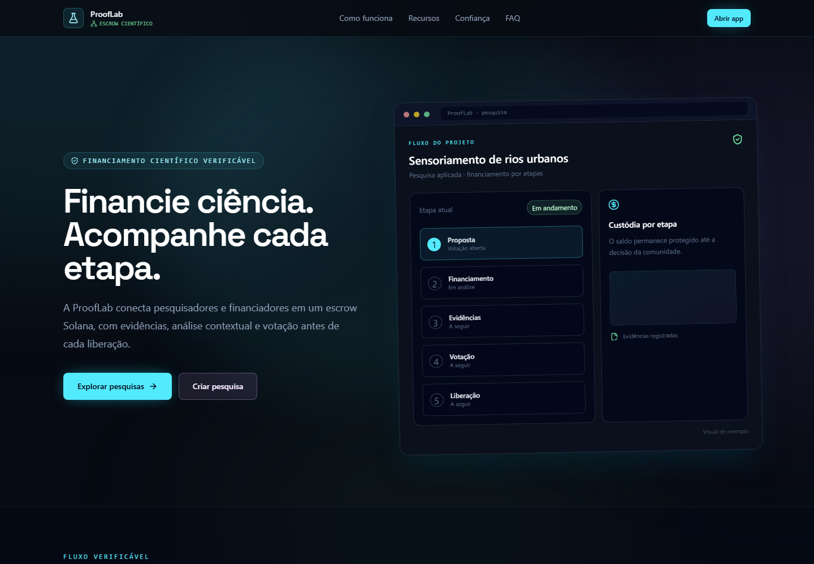

# ProofLab

ProofLab organiza financiamento científico por etapas, com evidências, votação dos financiadores e regras registradas em Solana Devnet.
A IA resume o material enviado, mas não aprova pesquisas nem libera recursos.



## Links

- [Site](https://prooflab.vercel.app)
- [API e Swagger](https://prooflab-9ffw.onrender.com/docs)
- [Código-fonte](https://github.com/ViniCPC/ProofLab)

## Stack

- Frontend: React, TypeScript, Vite, Tailwind CSS, React Router, Zustand e Solana Wallet Adapter.
- Backend: NestJS, Prisma, PostgreSQL, JWT, OpenAI Responses API e Solana Web3.js.
- Programa: Rust, Anchor, SPL Token e Solana Devnet.

## Rodar localmente

Pré-requisitos: Node.js 20+, npm, Docker e Docker Compose. Para compilar ou testar o programa Solana, instale também Rust, Solana CLI e Anchor.

```bash
git clone https://github.com/ViniCPC/ProofLab.git
cd ProofLab
docker compose up -d
```

Configure e inicie a API:

```bash
cd backend
npm ci
cp .env.example .env
npx prisma migrate deploy
npm run seed
npm run start:dev
```

Em outro terminal, inicie o frontend:

```bash
cd frontend
npm ci
cp .env.example .env
npm run dev
```

O frontend abre em `http://localhost:5173` e a API em `http://localhost:3000`.
